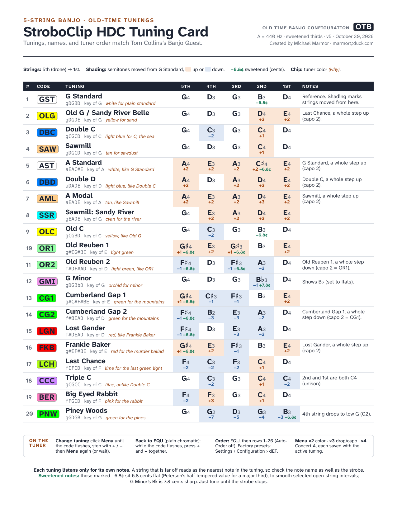

# OTB: old-time banjo tunings for the Peterson StroboClip HDC

> **Preview, October 30, 2026.** First public version. The tuner presets are not yet posted on Peterson's User Trading Post, and the card is out for review with the people it credits. Details may change; this page always has the latest version.

OTB, short for Old Time Banjo, is a set of 20 old-time banjo tunings loaded onto a Peterson StroboClip HDC clip-on strobe tuner as one configuration. Select a tuning and the tuner listens only for that tuning's five notes, shows the note nearest to what it hears, and takes that tuning's display color. The tunings are the common ones nearly every old-time player uses. Their names and order follow [Tom Collins's Banjo Quest](https://atlas.banjoquest.com/), so his students see one list. In each tuning the chord's major third is sweetened by 6.8 cents, Peterson's half-tempered value, and the plain EQU preset is one button press away.

## The card

Two pages: the tuning table, and "What OTB Is and How to Use It".

- [US Letter PDF](card/stroboclip-old-time-banjo-card_letter.pdf)
- [A4 PDF](card/stroboclip-old-time-banjo-card_a4.pdf)

Print page 1 only for the table alone.



## Get OTB onto your tuner

You need a StroboClip HDC (the HDC-B and HDC-V take the same configuration), a USB cable, a computer running Chrome or Edge, and a free account at [petersontuners.com](https://www.petersontuners.com/).

1. Plug in the tuner and open the [User Trading Post](https://www.petersontuners.com/sweeteners/shared/).
2. Under **Shared User Configurations**, find **OTB** and click **Add to My Tuner**.
3. Installing may replace a custom configuration already on your tuner. The factory presets are never lost: on the tuner, Settings, then Configuration, then `dEF` brings them back.

The [step-by-step guide](docs/guide.md) has the details, what the tuner shows, and what to do when something looks wrong. Until OTB is posted on the Trading Post, step 2 is not yet possible; see the Preview note above.

## The 20 tunings

Strings are listed 5th to 1st, as players write them. The code is what the tuner shows.

| # | Code | Tuning | Strings, 5th to 1st | Key |
|---|---|---|---|---|
| 1 | GST | G Standard | g D G B D | G |
| 2 | OLG | Old G / Sandy River Belle | g D G D E | G |
| 3 | DBC | Double C | g C G C D | C |
| 4 | SAW | Sawmill | g D G C D | G |
| 5 | AST | A Standard | a E A C♯ E | A |
| 6 | DBD | Double D | a D A D E | D |
| 7 | AML | A Modal | a E A D E | A |
| 8 | SSR | Sawmill: Sandy River | g E A D E | G |
| 9 | OLC | Old C | g C G B D | C |
| 10 | OR1 | Old Reuben 1 | g♯ E G♯ B E | E |
| 11 | OR2 | Old Reuben 2 | f♯ D F♯ A D | D |
| 12 | GMI | G Minor | g D G B♭ D | G |
| 13 | CG1 | Cumberland Gap 1 | g♯ C♯ F♯ B E | E |
| 14 | CG2 | Cumberland Gap 2 | f♯ B E A D | D |
| 15 | LGN | Lost Gander | f♯ D E A D | D |
| 16 | FKB | Frankie Baker | g♯ E F♯ B E | E |
| 17 | LCH | Last Chance | f C F C D | F |
| 18 | CCC | Triple C | g C G C C | C |
| 19 | BER | Big Eyed Rabbit | f F G C D | F |
| 20 | PNW | Piney Woods | g G D G B | G |

The card's table adds the octave of every string, the tuner's color for each tuning, how far each string moved from G Standard, and which notes are sweetened.

## Which tuners

Made on the StroboClip HDC. The HDC-B and HDC-V are the same tuner with different clips. Other Peterson tuners that work with Peterson Connect will be able to take the tunings one by one once they are shared as individual sweeteners. [Model by model](docs/compatibility.md).

## Sweetened, or plain EQU

[What the 6.8 cents are about](docs/sweetening.md), in plain words, and when to use EQU instead.

## Questions and corrections

Email Michael Marmor at marmor@duck.com. If you have a GitHub account, you can also [open an issue](https://github.com/mmarmor/stroboclip-old-time-banjo/issues).

## Building the card

The card is written in [Typst](https://typst.app/). From the `card/` folder:

```
typst compile --font-path fonts --ignore-system-fonts stroboclip-old-time-banjo-card.typ stroboclip-old-time-banjo-card_letter.pdf
typst compile --font-path fonts --ignore-system-fonts --input paper=a4 stroboclip-old-time-banjo-card.typ stroboclip-old-time-banjo-card_a4.pdf
```

The fonts travel with the repository, in `card/fonts/` with their license files: Atkinson Hyperlegible Next (SIL Open Font License 1.1) and DejaVu Sans (its own free license).

## Credits and license

Tunings, names and order from [Tom Collins's Banjo Quest](https://atlas.banjoquest.com/).

Card, text and source © 2026 Michael Marmor, released under [CC BY 4.0](LICENSE): share and adapt freely, with credit. The tunings themselves are traditional and belong to no one. Peterson, StroboClip and Sweetener are trademarks of Peterson Electro-Musical Products, Inc.; this project is not affiliated with Peterson.

## Versions

- v5, October 30, 2026: first public version (Preview). The version number is printed on both pages of the card.
