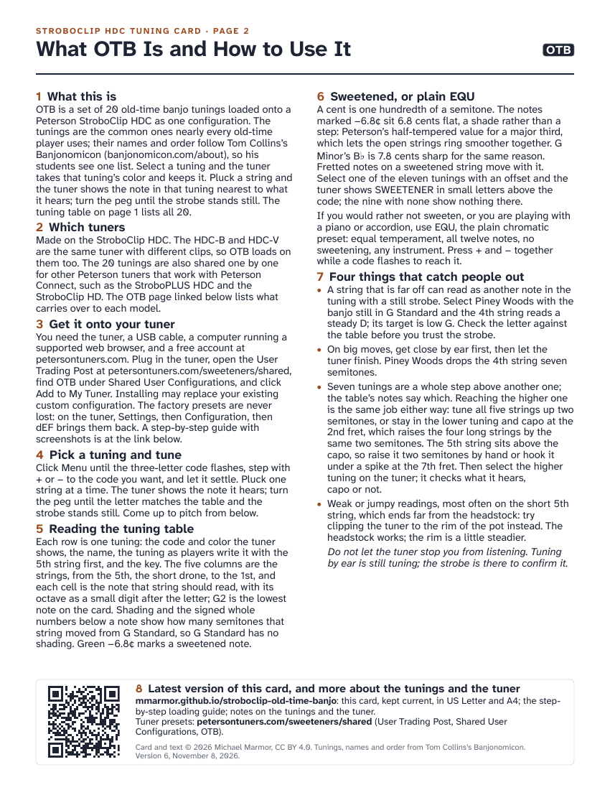

# The Old-Time Banjo Tuning Card for the Peterson StroboClip HDC

This is a two-page card to print and keep in the banjo case. Page 1 is a table of 20 old-time banjo tunings, in the names and order of [Tom Collins's Banjonomicon](https://banjonomicon.com/about), showing the note every string should read on a Peterson StroboClip HDC. Page 2 explains what the set is, how to get it onto the tuner, and how to use it at the banjo. OTB, for Old Time Banjo, is the name the tuner shows: the card goes with a matching set of 20 presets for the StroboClip HDC, so the tuner lists the same tunings, by the same names, in the same order, each in its own color.

**Download the card:** [US Letter PDF](card/stroboclip-old-time-banjo-card_letter.pdf) · [A4 PDF](card/stroboclip-old-time-banjo-card_a4.pdf). Two pages; print page 1 alone for the table.

<p>
<a href="card/stroboclip-old-time-banjo-card_letter.pdf"></a>
<a href="card/stroboclip-old-time-banjo-card_letter.pdf"></a>
</p>

*The two pages, reduced. The PDF is the card; the pictures are a preview.*

> **Status, November 8, 2026.** The card is final: version 6, checked line by line by Tom Collins against Banjonomicon. The tuner presets are not yet a one-click install: Peterson's User Trading Post does not yet list StroboClip HDC configurations, and I have asked Peterson to enable that. The 20 tunings are on the Trading Post one at a time, under Misc. Instruments. This note changes when that changes.

## Who this is for

You play old-time banjo, you meet a new tuning every few tunes, and you want the tuner to show the tuning by name instead of guessing chromatically. The card is for any banjo player with any tuner: the note and octave for every string in every tuning are right there. The presets are for the Peterson StroboClip HDC, and for the HDC-B and HDC-V, which are the same tuner with different clips.

## What is on the card

**Page 1, the table.** One row per tuning: the three-letter code and the color the tuner shows, the name, the tuning as players write it with the 5th string first, the key, and the five strings from the 5th to the 1st, each with the note it should read and its octave as a small digit. Shading and small signed numbers show how many semitones a string moved from G Standard. A green −6.8¢ marks a sweetened note, explained below.

**Page 2, "What OTB Is and How to Use It."** Eight short sections: what this is; which tuners; getting it onto your tuner; picking a tuning and tuning; reading the table; sweetened or plain EQU; four things that catch people out; and where the latest version lives, with a QR code that points here.

## The 20 tunings

Strings are listed 5th to 1st, as players write them. The code is what the tuner shows.

| # | Code | Tuning | Strings, 5th to 1st | Key |
|---|---|---|---|---|
| 1 | GST | G Standard | g D G B D | G |
| 2 | OLG | Old G / Sandy River Belle | g D G D E | G |
| 3 | DBC | Double C | g C G C D | C |
| 4 | SAW | Sawmill | g D G C D | G |
| 5 | AST | A Standard | a E A C♯ E | A |
| 6 | DBD | Double D | a D A D E | D |
| 7 | AML | A Modal | a E A D E | A |
| 8 | SSR | Sawmill: Sandy River | g E A D E | G |
| 9 | OLC | Old C | g C G B D | C |
| 10 | OR1 | Old Reuben 1 | g♯ E G♯ B E | E |
| 11 | OR2 | Old Reuben 2 | f♯ D F♯ A D | D |
| 12 | GMI | G Minor | g D G B♭ D | G |
| 13 | CG1 | Cumberland Gap 1 | g♯ C♯ F♯ B E | E |
| 14 | CG2 | Cumberland Gap 2 | f♯ B E A D | D |
| 15 | LGN | Lost Gander | f♯ D E A D | D |
| 16 | FKB | Frankie Baker | g♯ E F♯ B E | E |
| 17 | LCH | Last Chance | f C F C D | F |
| 18 | CCC | Triple C | g C G C C | C |
| 19 | BER | Big Eyed Rabbit | f F G C D | F |
| 20 | PNW | Piney Woods | g G D G B | G |

The card's table adds the octave of every string, the tuner's color for each tuning, how far each string moved from G Standard, and which notes are sweetened.

## Getting the presets onto your tuner

When OTB is listed under Shared User Configurations on Peterson's [User Trading Post](https://www.petersontuners.com/sweeteners/shared/), it is one click: plug the tuner into a computer running Chrome or Edge, sign in to your free [petersontuners.com](https://www.petersontuners.com/) account, find OTB, and click Add to My Tuner. Installing may replace a custom configuration already on the tuner; the factory presets are never lost (on the tuner, Settings, then Configuration, then `dEF` brings them back). The [step-by-step guide](docs/guide.md) covers the buttons, what the tuner shows, and what to do when something looks wrong.

Until then, the 20 tunings are on the Trading Post one at a time, under Misc. Instruments, each with its own Add To My Tuner Now button. I have not yet walked that path on my own tuner, so there are no step-by-step instructions for it here yet.

## A small refinement, and how to turn it off

In each tuning, the open string that sounds the chord's major third is set 6.8 cents flat, Peterson's half-tempered value for a sweetened third, so the open strings ring a little smoother together; in G Minor the B♭, a minor third, is 7.8 cents sharp for the same reason. A cent is a hundredth of a semitone; these are shades, not steps, and they are the green numbers on the card. If you would rather tune plain, or you are playing with a piano or accordion, use EQU, the plain chromatic preset: on the tuner, press + and − together while the code flashes. [What the 6.8 cents are about](docs/sweetening.md) explains it in plain words.

## Which tuners

Made on the StroboClip HDC. The HDC-B and HDC-V are the same tuner with different clips, so the presets load on them unchanged. Other Peterson tuners that work with Peterson Connect can take the 20 tunings one at a time from the Trading Post; the colors and the order belong to the HDC configuration and do not travel with a single tuning. [Model by model](docs/compatibility.md).

## Questions and corrections

Email Michael Marmor at marmor@duck.com. If you have a GitHub account, you can also [open an issue](https://github.com/mmarmor/stroboclip-old-time-banjo/issues).

## Building the card

The card is written in [Typst](https://typst.app/). From the `card/` folder:

```
typst compile --font-path fonts --ignore-system-fonts stroboclip-old-time-banjo-card.typ stroboclip-old-time-banjo-card_letter.pdf
typst compile --font-path fonts --ignore-system-fonts --input paper=a4 stroboclip-old-time-banjo-card.typ stroboclip-old-time-banjo-card_a4.pdf
```

The fonts travel with the repository, in `card/fonts/` with their license files: Atkinson Hyperlegible Next (SIL Open Font License 1.1) and DejaVu Sans (its own free license).

## Credits and license

Tunings, names and order from [Tom Collins's Banjonomicon](https://banjonomicon.com/about).

Card, text and source © 2026 Michael Marmor, released under [CC BY 4.0](LICENSE): share and adapt freely, with credit. The tunings themselves are traditional and belong to no one. Peterson, StroboClip and Sweetener are trademarks of Peterson Electro-Musical Products, Inc.; this project is not affiliated with Peterson.

## Versions

- Site, November 8, 2026: this page rewritten around the card, with a dated status note; the guide, compatibility and sweetening pages corrected (seven whole-step pairs, ten major thirds plus G Minor's minor third, the single tunings now shared).
- Card v6, November 8, 2026: credit corrected at Tom Collins's request. The tunings come from his Banjonomicon, not Banjo Quest; the card and this page now say so and link to banjonomicon.com/about. No change to the tunings.
- Card v5, October 30, 2026: first public version (Preview). The version number is printed on both pages of the card.
